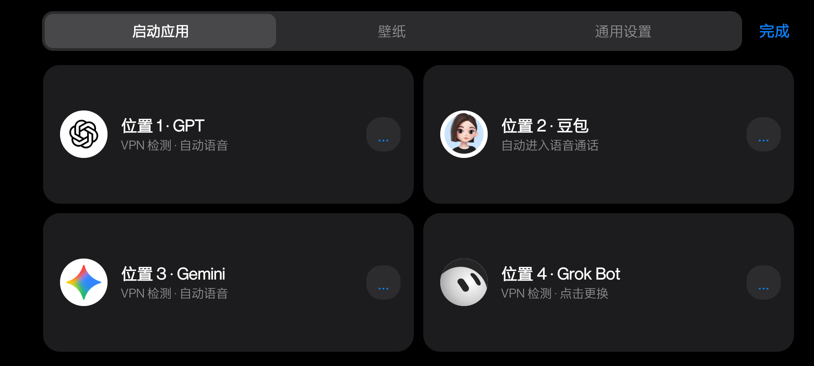
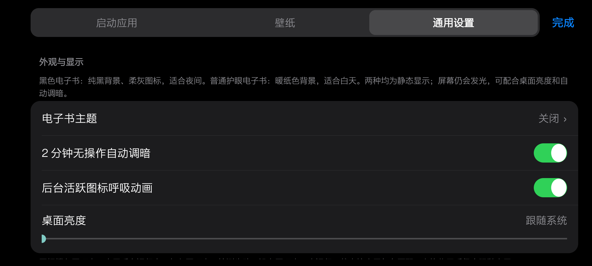

# Android-BT-QuickLaunch

[English](README.md)

一个极简的 Android 桌面（Launcher），让**蓝牙键盘 / 小键盘**变成实体快捷键，一键唤起你指定的应用。

把**二手安卓手机或闲置旧手机**改造成**车载 AI 语音终端**：通过蓝牙键盘快捷键一键启动应用，并自动进入 ChatGPT、Gemini 和豆包的语音入口。手机是 AI 助手与 Agent 工作流的客户端；本桌面自身不运行自主 Agent。

English search terms: second-hand Android phone, spare smartphone, phone reuse, Bluetooth keyboard, keypad shortcuts, one-button app launch, car launcher, voice assistant, AI Agent terminal.

## 项目背景

废旧安卓手机便宜、性能够用，却常年躺在抽屉里。本项目把它改造成**新时代智能车载终端**，用于语音聊天和 AI Agent 场景：一台专属的"Agent 的 Agent 客户端"，驾驶时不用点屏幕，只靠几个实体按键操作。

手机把本程序设为默认桌面，配对的蓝牙小键盘一键即可打开对应应用：AI 语音助手、导航、音乐等，中间没有任何菜单。

## 界面截图

| 桌面主界面 | 启动应用设置 | 通用设置 |
| :---: | :---: | :---: |
|  |  |  |

## 功能

- 固定横屏桌面，四个可配置应用位，长按可交换位置
- 蓝牙按键：双击 1/2/3 打开前三个位置；三键同按清理后台并回到桌面
- ChatGPT / Gemini 语音启动：检查本地网络与 VPN／代理状态，必要时启动 Clash Meta 并复检（不发起外网连通性探测）
- 清理成功后显示派大星图片及大字“搞定了”，并播放可单独关闭的系统短提示音；支持长按／双击 X 或键盘三键同按触发。
- 豆包启动后自动点击右上角电话按钮进入通话入口，按竖屏界面控件定位；通话仍受豆包账号额度限制。
- 豆包等待横竖屏切换后的电话按钮位置稳定，并确认通话页面后才结束流程；最多尝试三次，结合控件点击和已识别按钮位置的手势点击。
- Gemini Live 根据识别到的按钮位置执行手势点击，并确认当前版本的 Live 控件后才结束流程，支持有限重试，不使用固定屏幕坐标。
- 后台应用指示、电量 / Wi-Fi / 移动网络 / 蓝牙状态图标（支持通过 GATT 读取并显示蓝牙键盘电量）
- 彩色与电子书风格主题，自定义壁纸和图标
- 内置静态 XML 壁纸，默认纯黑，不解码大图、不播放动画、离线可用；用户仍可通过系统选择图片。
- 右上角显示整机内存占用比例，桌面可见且亮屏时每 10 秒刷新，点击查看容量；可用内存包含可回收内存。
- 电子书主题提供“黑色电子书主题”“普通护眼模式电子书主题”和关闭选项；黑色版使用纯黑背景与柔灰图标，普通版使用暖纸色，旧版纸白设置沿用普通版。内存以芯片图标与百分比显示。
- 提醒按事件独立配置：每行显示已保存的语音或音效，选择与试听在同一窗口完成，保存后生效，取消不改变原设置；未单独设置的事件沿用旧版选择。
- 后台运行的应用图标显示橙色圆环，状态跟随应用包名而非固定坐标；交换位置后仍正确匹配，清理成功后立即刷新。
- 内置 8 段 Android AOSP 系统提示音，普通提醒与清理成功音效可分别选择、试听和保存；只播放应用资源，不依赖手机系统文件，不支持外部导入。
- 应用图标统一按圆形显示，包括自定义图标；保留原始图片文件，清理 X 图标保持原样。
- 新增车载／蓝牙组合应用图标，支持 Android 自适应图标
- 2 分钟空闲自动调暗，降低 OLED 烧屏风险
- 断联后快速回连已配对键盘（快速重试 3 次，休眠期被动等待唤醒以免撞车）
- 键盘连接／断开提示音优先响应 HID／ACL 广播，并以 1 秒轮询兜底；Root 回连独立执行。键盘突然断电后的失联确认仍受系统蓝牙超时影响。
- 语音／提示音需要开启手机响铃模式；静音或振动模式仅震动。听不到语音时，请先开启响铃并检查媒体音量。
- 离线提醒：键盘连接／断开、连接或断开时键盘电量低于 30%、未充电时手机电量低于 30%。设置提供总开关、四项独立开关和“提示音／提示语音”选择，默认全部开启并使用提示语音。
- 配置导入导出（ZIP）、日志导出、崩溃记录，以及在设置中临时进入系统经典桌面
- 设置页应用内自动升级（默认使用 GitHub Releases，启动后延迟 6 秒后台检查以免影响启动速度，安装前校验 APK 包名完整性，失败时引导并支持一键打开 Release 页面）

## 环境与限制

> 目前针对单一设备调校，**还不是**通用桌面。

- 在一加 7T（HD1900）、Android 11、Magisk Root 上开发和测试
- 清理后台和主动回连 HID 键盘需要 Root（使用 Android 11 隐藏的蓝牙 HID 接口）
- 无障碍服务用于读取键盘按键和识别 ChatGPT 语音按钮，ChatGPT 界面更新后可能需要适配
- 键盘地址在 [`DeviceConfig.java`](launcher-app/src/com/benbenyu/btquicklaunch/DeviceConfig.java) 中设置，请改成你自己的键盘
- 目前界面文字以中文为主，后续会做多语言
- **中国广电（`46015`）SIM 卡提示**：较早的 Android 11 系统（含一加 7T）可能未内置广电 APN；若首页和系统均显示 4G 满格信号但移动数据无法上网，请在系统 **设置 -> 移动网络 -> 接入点名称 (APN)** 中手动新增（名称：`中国广电`，APN：`cbnet`，APN 类型：`default,supl`）并保存选中

验证情况见 [docs/STATUS.md](docs/STATUS.md)。

## 构建

需要 Windows PowerShell、JDK 17、Android SDK platform 30 与 build-tools（或本地 `.tools` 缓存）。

```powershell
.\build-home.ps1
```

产物：`dist/BT-QuickLaunch-v<版本>.apk`。首次构建会在 `.keys/` 生成本地签名密钥，请妥善保管并持续复用，否则无法覆盖升级。

## 安装

```bash
adb install -r dist/BT-QuickLaunch-v1.7.5.apk
adb shell cmd package set-home-activity com.benbenyu.btquicklaunch/.MainActivity
```

然后开启无障碍服务、配对键盘；如需开机自动恢复，把 `phone-config/92-btquicklaunch.sh` 放到 `/data/adb/service.d/`（权限 755）。

## 目录结构

项目背景、按钮识别的实际规则、可靠性边界和后续迭代说明见[项目知识背景](docs/PROJECT_CONTEXT.zh-CN.md)。当前使用无障碍资源 ID **及无障碍描述**识别，不使用 OCR 或固定坐标识别；语音按钮匹配目前没有读取控件可见文字。这里的“无障碍 ID／控件 ID”指同一类资源标识，不是两套识别方式。

开发前必须阅读 [AGENTS.md](AGENTS.md) 和 [CONTRIBUTING.md](CONTRIBUTING.md)，再阅读项目背景、架构及状态。文档默认英文，各有独立简体中文版，两种语言必须在同一提交同步更新。

| 文档 | English（默认） | 简体中文 |
|---|---|---|
| 项目背景与迭代指南 | [EN](docs/PROJECT_CONTEXT.md) | [CN](docs/PROJECT_CONTEXT.zh-CN.md) |
| 架构 | [EN](docs/ARCHITECTURE.md) | [CN](docs/ARCHITECTURE.zh-CN.md) |
| 状态与验证 | [EN](docs/STATUS.md) | [CN](docs/STATUS.zh-CN.md) |
| 离线提醒 | [EN](docs/VOICE_ALERTS.md) | [CN](docs/VOICE_ALERTS.zh-CN.md) |

| 路径 | 内容 |
|---|---|
| `launcher-app/` | Android 应用源码、Manifest、资源、设备检查 |
| `phone-config/` | Magisk 开机脚本、设备测试脚本 |
| `build-home.ps1` | 构建与签名脚本 |
| `release.ps1` | GitHub Releases 自动发布脚本（可选 `-IncludeGitee`） |
| `docs/` | 架构、项目状态与 README 截图（`docs/images/`） |
| `CONTRIBUTING.md` | 贡献规则（中英文 README 必须同步） |

## 许可证

源代码：[MIT](LICENSE)。第三方素材：[许可与来源说明](THIRD_PARTY_NOTICES.md)。
